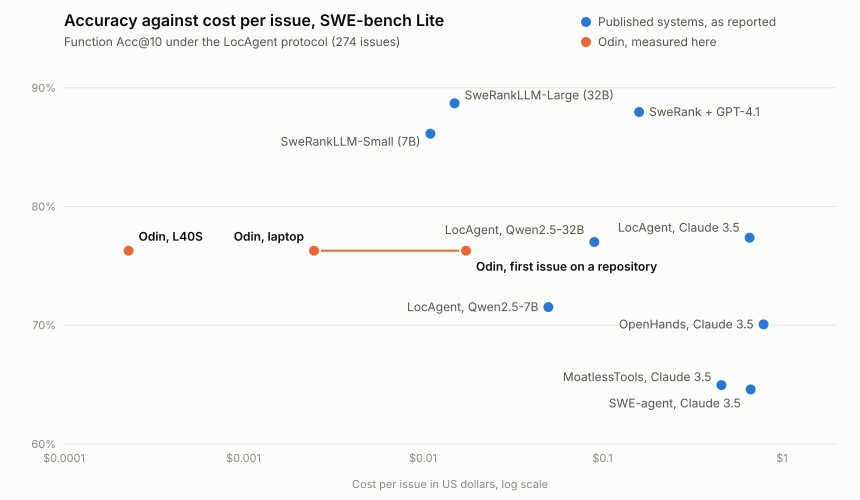
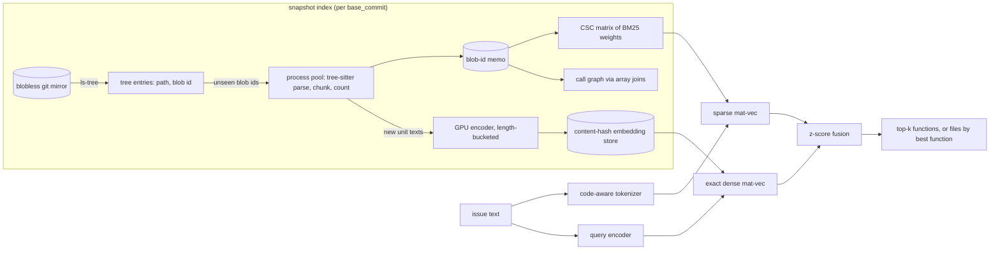
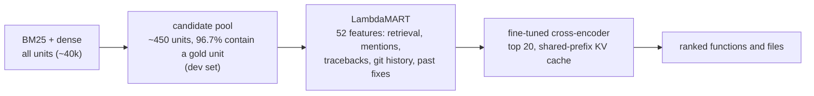
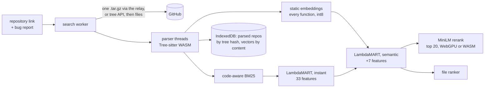

# Odin

Bug localization over any git commit: structural chunking, code-aware BM25 and content-addressed code embeddings for recall, then a learned LambdaMART ranker and a fine-tuned LLM cross-encoder for precision, all measured against real bug fixes.

The question this project answers: **given a bug report, can we find the code that has to change?** Every design decision is scored on SWE-bench issues, where the ground truth is the set of functions the maintainers' actual fix touched, and every claimed improvement comes with a paired significance test.

It ships two ways:

- **A research pipeline** (`src/odin`, Python): the full cascade on a GPU, evaluated on SWE-bench Lite.
- **A website that runs entirely in the browser**, on any public Python repository: **[allfather.dev](https://allfather.dev/)**. Paste a repository and a bug report; parsing, indexing, embedding and ranking happen on your device.

## Headline results

SWE-bench Lite test, 300 issues across 12 repositories, each searched at its own `base_commit`, out of roughly 10k to 45k candidate functions per snapshot. Nothing was trained or tuned on these issues. File-level rows score all 300; function-level rows score 291, the 300 minus the 9 whose fix touches only module-level code and so has no function or class to find.

| Final system (`ltr-ce-notests`) | hit@1 | hit@5 | hit@10 | recall@10 | MRR |
|---|---|---|---|---|---|
| **File that must change** (300 issues) | 69.0% | **89.3%** | **93.0%** | 0.930 [0.90, 0.96] | 0.783 |
| **Function that must change** (291 issues) | 45.0% | 73.9% | **79.4%** | 0.772 [0.72, 0.82] | 0.560 |

*hit@k*: at least one location the maintainers' fix touched is in the top k. Brackets are 95% bootstrap intervals.

For reference, plain BM25 started this project at 32.6% function hit@10 (recall@10 0.308, against 0.772 now).

### Next to published systems

Scored the way LocAgent and SweRank score themselves: 274 Lite issues, and an issue counts only when every location its fix changed is in the top k (Acc@k, in %).

| System | Models | Source | File Acc@1 | File Acc@5 | Function Acc@5 | Function Acc@10 |
|---|---|---|---|---|---|---|
| OpenHands | Claude 3.5 | reported | 76.28 | 90.15 | 68.25 | 70.07 |
| LocAgent | Claude 3.5 | reported | 77.74 | 94.16 | 73.36 | 77.37 |
| SweRank | 7B retriever, 32B reranker | reported | 83.21 | 95.99 | 81.39 | 88.69 |
| Odin (`ltr-ce-notests`) | 0.5B retriever, 0.6B reranker | scored here | 68.98 | 90.51 | 70.80 | 76.28 |

Odin is level with the best agent of the LocAgent paper at function level and behind SweRank, with models an order of magnitude smaller; it is behind both at file level. The other rows are copied from the papers' tables and have not been re-run here. Sources, every other row, intervals, costs and what this means for the plan are in [docs/comparison.md](docs/comparison.md); the rules were fixed beforehand in [ADR 0014](docs/decisions/0014-comparison-protocols.md).

### What it costs

The full cascade takes 8.8 seconds per issue on a laptop GPU (RTX 4050, 6 GB), median 3.5 seconds, and the reranker is 96% of that. At a public GPU rental price that is about $0.0025 per issue, against $0.011 to $0.015 for SweRank's rerankers and $0.46 to $0.79 for agents running Claude 3.5, as their papers report them. The stage-by-stage table, the assumptions behind the dollar figure and the chart are in [docs/cost.md](docs/cost.md).



### In the browser, on projects it never saw

The website runs a lighter pipeline (no GPU, no git history) with rankers trained on 5,115 issues from 131 projects. It is scored on 30 projects kept out of training entirely, the situation of every repository a visitor pastes: 747 bugs, the 785 sampled minus the 38 with no function or class target ([ADR 0011](docs/decisions/0011-website-at-scale.md)):

| In-browser stage | hit@1 | hit@10 | MRR |
|---|---|---|---|
| keyword search only | 32.8% | 66.1% | 0.435 |
| instant learned ranking | 43.8% | 75.5% | 0.543 |
| + static-embedding semantic index | 43.4% | 77.2% | 0.542 |
| + MiniLM rerank of the top 20 | 43.9% | **77.2%** | **0.551** |
| **file ranker** (the file that must change) | 69.2% | **94.4%** | 0.781 |

Against the previous browser ranker, trained on SWE-bench alone: function hit@10 +1.3 points (p = 0.049) and file hit@10 +1.9 points (p = 0.005) on the unseen projects. On SWE-bench Lite (291 issues) the browser pipeline reaches 69.1% function hit@10 against the GPU pipeline's 79.4%.

### Every retriever

File rows: 300 issues. Function rows: 291 issues (300 minus the 9 that are module-level only).

| Retriever | Level | Recall@1 | Recall@5 | Recall@10 | All@10 | MRR |
|---|---|---|---|---|---|---|
| random | file | 0.003 | 0.013 | 0.017 [0.00, 0.03] | 0.017 | 0.008 |
| bm25-naive | file | 0.340 | 0.617 | 0.693 [0.64, 0.75] | 0.693 | 0.457 |
| bm25-code | file | 0.363 | 0.647 | 0.727 [0.67, 0.78] | 0.727 | 0.487 |
| bm25-code-notests | file | 0.457 | 0.723 | 0.790 [0.74, 0.83] | 0.790 | 0.571 |
| dense-notests | file | 0.483 | 0.800 | 0.873 [0.83, 0.91] | 0.873 | 0.621 |
| hybrid-notests | file | 0.583 | 0.850 | 0.917 [0.88, 0.95] | 0.917 | 0.698 |
| ltr-notests | file | 0.627 | 0.883 | 0.930 [0.90, 0.96] | 0.930 | 0.741 |
| **ltr-ce-notests** | file | **0.690** | **0.893** | **0.930** [0.90, 0.96] | 0.930 | **0.783** |
| bm25-naive | function | 0.141 | 0.249 | 0.308 [0.26, 0.36] | 0.289 | 0.203 |
| bm25-code | function | 0.154 | 0.329 | 0.428 [0.37, 0.49] | 0.406 | 0.247 |
| bm25-code-notests | function | 0.190 | 0.427 | 0.519 [0.46, 0.58] | 0.491 | 0.307 |
| bm25-code-notests-graph | function | 0.194 | 0.427 | 0.523 [0.47, 0.58] | 0.495 | 0.312 |
| dense-notests | function | 0.225 | 0.479 | 0.586 [0.53, 0.64] | 0.564 | 0.365 |
| hybrid-notests | function | 0.269 | 0.569 | 0.642 [0.59, 0.69] | 0.622 | 0.416 |
| ltr-notests | function | 0.344 | 0.643 | 0.729 [0.68, 0.78] | 0.708 | 0.497 |
| **ltr-ce-notests** | function | **0.407** | **0.706** | **0.772** [0.72, 0.82] | 0.746 | **0.560** |

Every tunable choice was made on data disjoint from Lite: a dev set (SWE-bench Verified minus Lite) for fusion and expansion, and SWE-bench test minus Lite (1,941 issues) for the learned rankers.

### What each step bought (paired bootstrap, function level, 291 issues: 300 minus 9 module-level-only)

| Change | ΔRecall@10 | 95% CI | p | Wins / losses |
|---|---|---|---|---|
| naive → code-aware tokenizer | **+0.121** | [+0.076, +0.166] | <0.001 | 50 / 11 |
| + exclude test files | **+0.091** | [+0.058, +0.126] | <0.001 | 32 / 2 |
| + call-graph expansion (dev-tuned) | +0.003 | [+0.000, +0.010] | 0.72 | 1 / 0 |
| BM25 → dense embeddings alone | +0.066 | [+0.002, +0.129] | 0.045 | 63 / 43 |
| dense → hybrid (dev-tuned fusion) | **+0.057** | [+0.019, +0.096] | 0.002 | 30 / 11 |
| **BM25 → hybrid, overall** | **+0.123** | [+0.070, +0.174] | <0.001 | 57 / 17 |
| hybrid → learning to rank (LambdaMART) | **+0.087** | [+0.049, +0.128] | <0.001 | 36 / 9 |
| LTR → + fine-tuned cross-encoder (ensemble of 2) | **+0.043** | [+0.013, +0.074] | 0.005 | 24 / 7 |

The cross-encoder's main job is the top of the list: function MRR +0.063 and recall@1 +0.063 (both p < 0.01), file MRR +0.042 and recall@1 +0.063 (p < 0.01). Earlier LTR and cross-encoder numbers were measured on a corrupted embedding store and are superseded ([ADR 0008](docs/decisions/0008-embedding-store-corruption.md)).

- **Code-aware tokenization** splits `get_queryset` and `HTTPServerError` into parts and keeps the whole identifier too, so both prose ("query set") and exact mentions match. It helps most at depth. At recall@1 the gain (+0.012) is not significant.
- **Excluding tests** is the largest lexical win at recall@1 (+0.037, p = 0.006); hybrid retrieval, learning to rank and the cross-encoder each add more later. Test methods reuse every identifier in the issue, so they crowd out the source.
- **Call-graph expansion does not pay for itself.** It was tuned on a held-out dev set and confirmed on test. [ADR 0004](docs/decisions/0004-call-graph-expansion.md) shows why: only 15% of misses are one call away from a top hit, so the ceiling is low. It ships as opt-in.
- **Learning to rank turns many weak signals into one ordering** ([ADR 0006](docs/decisions/0006-learning-to-rank.md)). The candidate pool already held a gold unit for 96.7% of issues, measured on the dev set, so the remaining errors were about order. LambdaMART learns it from 52 features: retrieval scores, the issue title and code spans scored separately, traceback frames and names mentioned in the issue, file structure, git history from strict ancestors of the base commit (BugLocator-style churn and similar past commits), and fixes of similar earlier issues.
- **A fine-tuned LLM reranker reads the issue and the code together** ([ADR 0007](docs/decisions/0007-fine-tuned-cross-encoder.md)). Zero-shot it added nothing, but after one LoRA epoch on in-domain hard negatives it lifts the top ranks. It runs only on the top 20, with a shared-prefix KV cache so the issue is encoded once per query rather than once per candidate.
- **Hybrid is the big win, because the two retrievers fail differently.** Dense alone is only marginally better than BM25 (p = 0.045), but fusing them beats both. Recall@10 is +12.7 points at file level too, with 42 wins to 4 losses. The largest gains are where issues aren't written in identifiers: sympy recall@10 went from 0.37 to 0.59 and pytest from 0.30 to 0.56 ([ADR 0005](docs/decisions/0005-dense-hybrid-retrieval.md)).

Reproduce any row: `make eval RETRIEVER=bm25-code-notests LEVEL=function`, then `uv run odin compare results/A.json results/B.json`.

## Performance

Indexing every Lite snapshot at function level and answering its issue with `bm25-code-notests`: 291 snapshots, 188,880 files. Measured on 2026-10-13 on a laptop (Core i5-13420H, 12 logical cores, 32 GB, Windows 11) by `benchmarks/bench_lite_index.py`; the output is [results/perf/lite_index_2026-10-13.json](results/perf/lite_index_2026-10-13.json).

| | No disk cache | Cold disk cache | Warm disk cache |
|---|---|---|---|
| End-to-end wall time | 110 s | 119 s | **43 s** |
| Index build p50 / p95 | 276 / 630 ms | 304 / 762 ms | **101 / 216 ms** |
| Query latency p50 / p99 | 0.43 / 1.14 ms | 0.39 / 0.89 ms | 0.38 / 0.96 ms |
| Blobs parsed | 26,159 | 26,148 | 0 |

- **Within one run, 86% of files are never parsed.** They are byte-identical to a file in a snapshot already indexed, so 188,880 files cost 26,159 parses.
- **The analysis cache** (SQLite, keyed by blob id plus a fingerprint of the parser and tokenizer *source code*, so editing either invalidates exactly the stale entries) carries that reuse across runs: a repeat run takes 43 s.
- **The ranked output is identical in all three runs.** The benchmark hashes every ranking and compares.

An earlier version of this table compared against the project's first working version. That code predates the git history and cannot be run again, so the comparison was removed rather than kept unverifiable.

Where the time went, and what fixed it:

- **Git reads.** One long-lived `git cat-file --batch` process instead of two subprocesses per file.
- **Content addressing: 7× less parsing.** Work is memoized by blob id, and most files in a snapshot are byte-identical to a file in a snapshot already indexed.
- **Bulk fetch.** Each repository's missing blobs for every needed commit are found with one `cat-file --batch-check` (lazy fetch disabled) and downloaded with one `git fetch --stdin`, instead of one lazy round trip per object.
- **No Python loop over documents.** BM25 weights are precomputed into a scipy CSC matrix, so a query is a column slice plus one sparse mat-vec. Path terms are added to every chunk with a single sparse product, and the call graph is resolved with sorted-array joins.
- **Tokenization collapses repeats in C.** `Counter(re.findall(...))` runs first, so each distinct identifier is split once, not once per occurrence.
- **Parsing in a process pool.** Tree-sitter holds the GIL, so threads did nothing. Workers return compact arrays against a blob-local term table, and the main process interns each blob's distinct terms with one gather.

### Dense retrieval

| | |
|---|---|
| Unit slots across the 684 snapshots evaluated at function level (291 Lite, 393 dev) | 6.67M |
| Distinct unit texts actually embedded (content-hash store) | **185k (36.1× fewer)** |
| GPU time to embed them at the 204 units/s measured below (RTX 4050, fp16) | about 15 min, instead of about 9 h |
| Units that needed embedding for the Lite run after dev tuning | 8.5k |

Batching (4000 django units, `benchmarks/bench_batching.py`, output in [results/perf/bench_batching_2026-10-13.json](results/perf/bench_batching_2026-10-13.json)):

| Strategy | Units/s | Real / padded tokens |
|---|---|---|
| Fixed batches of 32 in file order | 42 | 21% |
| Length-sorted, batches of 32 | 199 | 98% |
| **Length-sorted, 4096-token budget** | **204** | 98% |

Sorting is nearly all of the 4.9× gain. Budget packing adds about 3%, and larger budgets are slower once the GPU is saturated.

**Why not A\*, WAND or HNSW?** Pruning search (best-first graph search in HNSW, admissible upper bounds in WAND/MaxScore) buys cheaper scoring with extra build work. On a django snapshot of 8,863 units (`benchmarks/bench_search.py`, output in [results/perf/bench_search_2026-10-13.json](results/perf/bench_search_2026-10-13.json)):

| Step | ms |
|---|---|
| Encode the issue text (GPU) | 27 |
| BM25 over all units | 0.06 |
| Exact dense search, GPU / CPU | 0.14 / 0.49 |
| HNSW build (FAISS, M=16 / M=32) | 639 / 666 |
| HNSW query | 0.07 to 0.24 |

Each snapshot answers one query, so HNSW would need about 10,000 queries on the same commit to repay its build against exact search on the GPU (639 ms of build for 0.06 ms saved per query). Exact search is both faster and lossless here. The time that matters is query encoding and indexing new code, which is where the optimization went.

## Architecture



The ranking cascade on top: each stage is more expensive per candidate and sees fewer of them.



The same cascade in the browser, with no server of its own:



- **Chunk = the unit ground truth is labelled with.** Each non-nested function, method and class is a chunk. A class chunk holds only the lines its methods don't own (header, docstring, attributes). Everything else is a module chunk used for file-level search.
- **Every issue is searched at its own `base_commit`.** Searching at HEAD leaks the fix ([ADR 0002](docs/decisions/0002-index-at-base-commit.md)).

## Tech stack

| Layer | Tools |
|---|---|
| Research pipeline | Python 3.11+, uv, Tree-sitter, NumPy/SciPy (sparse BM25), PyTorch + sentence-transformers (jina-code embeddings), LightGBM (LambdaMART), Hugging Face PEFT/LoRA on Qwen3 (cross-encoder), SQLite (analysis cache), git (blobless mirrors, `cat-file --batch`) |
| Website | TypeScript (strict), Preact, Vite, Web Workers, Tree-sitter compiled to WebAssembly, Model2Vec static embeddings (int8), Transformers.js + ONNX Runtime (MiniLM on WebGPU or WASM), IndexedDB, a service worker (COOP/COEP isolation, offline cache) |
| Hosting | One Cloudflare Worker at allfather.dev: static files plus a relay for repository archives at `/relay` (`deploy/cloudflare/`, `proxy/`) |
| Quality | pytest, Vitest, Playwright end-to-end tests (desktop and phone), a Python/TypeScript parity suite, ruff, GitHub Actions CI, axe accessibility checks |
| Data | SWE-bench (Lite, Verified, full), SWE-rebench (CC-BY-4.0) for 150 more projects |

## Evaluation methodology

- **Ground truth** comes from the gold patch, mapped onto a Tree-sitter parse of each file *as it existed at `base_commit`* (details below).
- **Unseen projects for the website.** The browser's rankers are cross-validated with whole projects as folds, and scored on 30 SWE-rebench projects that appear in no training fold, so the reported numbers are what a visitor's new repository gets.
- **Held-out tuning.** Anything with a knob is tuned off Lite: fusion and expansion on SWE-bench Verified minus Lite (407 issues, `odin tune`), learned rankers on SWE-bench test minus Lite (1,941 issues, `odin ltr`, 5-fold CV grouped by query), and the reranker's depth and weights on 250 issues held out from its training (`odin ce-tune`), with the selection rule written down before looking.
- **How often Lite has been looked at.** No number here was trained or tuned on Lite, but Lite is not untouched: it has been scored 77 times, and [results/test-evals.log](results/test-evals.log) lists each one with what was decided from it. Most are one run per reported row. The exceptions: the early browser pipeline was scored on Lite at several rerank depths and with two stage-2 models (its settings were chosen on dev data and cross-validation, but Lite was looked at each time), and the distilled reranker was rejected on a Lite result, a decision taken on the test set, in the conservative direction. Every later evaluation appends to the log.
- **A sealed holdout for what comes next.** 324 issues created on or after 2025-09-01, after the cascade's models were published, from 189 projects that appear in no training, dev or test data here; 311 of them have a function-level target. Nothing has been evaluated on it. Only three final configurations ever will be, each once per level, and `odin eval` refuses anything else ([ADR 0013](docs/decisions/0013-sealed-holdout.md)).
- **No leakage through features.** Git history uses only strict ancestors of the base commit (`git rev-list`). Earlier-issue features only see issues opened at least 30 days before the query. Both boundaries have tests.
- **Reproducibility.** Cached features and trained models carry a fingerprint of the source code that produced them, and a model refuses to load against different feature code. Every result file records the git commit, library versions, model hashes and command line.
- **Significance.** `odin compare` runs a paired bootstrap over queries (10k resamples) and reports Δ, a 95% CI, a two-sided p-value and win/loss counts. A difference that isn't significant is reported as such.
- **Honest latency.** Index construction is timed separately from query latency, and both are reported with p50/p95/p99.
- **Per-repo breakdown** is in every result file, so django (108 of 291 issues) cannot hide a regression elsewhere.

<details>
<summary>Per-repository results, function level: BM25 vs hybrid</summary>

| Repository | Issues | BM25 recall@10 | Hybrid recall@10 | BM25 MRR | Hybrid MRR |
|---|---|---|---|---|---|
| django/django | 108 | 0.59 | 0.67 | 0.37 | 0.45 |
| sympy/sympy | 75 | 0.37 | **0.59** | 0.20 | **0.41** |
| matplotlib/matplotlib | 23 | 0.45 | 0.53 | 0.34 | 0.32 |
| scikit-learn/scikit-learn | 23 | 0.61 | 0.70 | 0.38 | 0.49 |
| pytest-dev/pytest | 16 | 0.30 | **0.56** | 0.13 | 0.20 |
| sphinx-doc/sphinx | 16 | 0.66 | 0.75 | 0.28 | 0.35 |
| astropy/astropy | 6 | 0.67 | 0.71 | 0.45 | 0.62 |
| psf/requests | 6 | 0.83 | 0.83 | 0.48 | 0.47 |
| pylint-dev/pylint | 6 | 0.67 | 0.50 | 0.44 | 0.38 |
| pydata/xarray | 5 | 0.40 | 0.60 | 0.25 | 0.37 |
| mwaskom/seaborn | 4 | 0.75 | 0.75 | 0.21 | 0.21 |
| pallets/flask | 3 | 0.50 | 1.00 | 0.39 | 0.78 |

sympy and pytest were the hard cases for BM25: sympy issues are often written in mathematical notation rather than identifiers, and pytest issues describe the behaviour of a tool whose source shares its vocabulary with its tests. Those are exactly the repos where embeddings helped most. The small repos have too few issues to read much into.
</details>

## Quick start

```bash
uv sync                                          # lexical engine only, no PyTorch
uv sync --extra dense                            # + CUDA PyTorch and the embedding model
make gold                                        # ground truth (committed; rebuild to verify)
make eval RETRIEVER=hybrid-notests LEVEL=function
uv run odin gold --dataset full                  # training ground truth (2,294 issues)
uv run odin ltr                                  # LambdaMART models (committed in models/)
make adapters                                    # the two reranker adapters from Hugging Face, checksum-verified (private for now: needs a login)
make reranker                                    # or train them: two adapters and the ensemble weights
make eval RETRIEVER=ltr-ce-notests LEVEL=function
uv run odin compare results/bm25-code_function_lite_test.json \
                    results/bm25-code-notests_function_lite_test.json
uv run odin search psf/requests "redirect drops the authorization header" --no-tests
make test

# the website's rankers (SWE-bench + 150 SWE-rebench projects; ground truth committed)
uv run python scripts/sample_rebench.py         # the fixed project sample (committed)
uv run odin gold --dataset rebench --split train
uv run python scripts/browser_ltr.py            # trains, cross-validates, exports web/src/assets/
```

The first evaluation clones 12 blobless mirrors (about 400 MB) and fetches the source blobs for every needed commit in one request per repository. Later runs are offline.

Retrievers: `random`, `oracle`, `bm25-naive`, `bm25-code`, `bm25-code-notests`, `bm25-code-notests-graph`, and with the `dense` extra `dense-notests`, `hybrid-notests`, `ltr-notests`, `ltr-ce-notests` and `ltr-ce-distilled-notests` (a single distilled reranker; tried, not adopted). The first dense run embeds about 185k units (about 15 minutes on a laptop GPU). Later runs reuse `.cache/embeddings`.

## Website

`web/` is the product site: **TypeScript + Vite + Preact**, deployed to [allfather.dev](https://allfather.dev/) as a Cloudflare Worker with static assets ([docs/deploy.md](docs/deploy.md)). Everything runs in the visitor's browser; there is no server. Pages are hash routes, so any static host works: Home, `#/search`, `#/how-it-works`, `#/benchmarks` and `#/explore/<issue>`; older `?repo=` and `#issue=` links redirect.

- **Search any public Python repository.** It accepts `owner/name`, https or ssh URLs, and links to a branch, a folder (the search is then limited to it), a file, an issue or a pull request. Over the browser budget (6,000 files, 60 MB) it keeps the project's own code and drops docs, examples and vendored code first; committed virtualenvs are skipped. A Web Worker lists the repository through GitHub's API and downloads its Python files (or one `.tar.gz` through an optional CORS relay, `proxy/`), parser threads split them into functions with Tree-sitter compiled to WebAssembly, and a code-aware BM25 index is built. Large repositories are searchable while they load. A learned ranker (LambdaMART, exported as JSON trees) orders candidates using what the issue names: traceback frames, quoted identifiers, module paths and title matches. In the background, a static code-embedding model (Model2Vec potion-code-16M, int8, 16.8 MB) embeds every function in seconds, a second ranker adds meaning to the evidence, and a small language model (MiniLM, WebGPU or WebAssembly) reranks the top 20. A file ranker orders whole files. Parsed repositories are cached in IndexedDB by git tree hash, embeddings by content hash; the main thread never blocks.
- **Measured on projects it never saw.** `scripts/browser_ltr.py` trains the browser's rankers on 5,115 issues from 131 projects (SWE-bench minus Lite plus 120 projects sampled from SWE-rebench), choosing settings by project-grouped cross-validation, then scores this exact pipeline once on held-out data. On 747 bugs from 30 projects kept out of training entirely, a function the fix changed is in the top 10 for 77.2% (hit@10; keyword search alone 66.1%), and the file ranker finds the file in the top 10 for 94.4%. A parity test runs the TypeScript features, tokenizer and embeddings against the Python ones, value for value. See [ADR 0011](docs/decisions/0011-website-at-scale.md).
- **Replayed results of the full pipeline.** Stage-by-stage metrics with confidence intervals, significance tests, per-project tables, and an explorer that tells each of the 300 Lite issues as a story: the report, the answer key, and where every stage ranked the fix. Explorer views are deep-linkable (`#/explore/django__django-11019`); *Beat Odin* (`#/explore?mode=game`) lets visitors guess the fixed file against Odin's pick.
- **UX.** Real open issues from the loaded repository as one-click queries; "Why #1?" bars showing what each kind of evidence added to a result's score; when a result's file last changed; a map of the repository with the results lit; an "Odin this" bookmarklet that opens any GitHub issue in Odin; a command palette (Ctrl+K); Functions/Files views, syntax-highlighted code, shareable `#/search?repo=&q=` links, cancel, recent repositories, `/` to focus, and a light/dark toggle (light by default).

The engine in `web/src/engine/` is a port of the chunker, tokenizer and BM25. `tests/test_site_engine.py` runs that TypeScript source directly under Node 24 and requires unit-for-unit agreement with the Python chunker, identical BM25 rankings and scores, identical ranker features and identical static embeddings, on Odin's own source files and a set of adversarial strings. `scripts/parity_run.py` (`make parity`, also a weekly CI job) repeats the chunker and BM25 comparison on pinned commits of django, sympy and requests: 1,845 files and 31,892 units chunk identically, scores agree to within 1e-5, and 46 of 46 queries return the same top 10 ([results/parity_pinned_2026-10-13b.json](results/parity_pinned_2026-10-13b.json)). Before ties at a cut-off were broken by index in Python as in the browser, 2 of the 46 differed by tied units ([ADR 0016](docs/decisions/0016-deterministic-ties.md)). `web/test/` holds Vitest unit tests, including a check that highlighted repository code can never inject markup.

```bash
cd web && npm ci && npm run dev        # http://localhost:5173
npm test && npm run typecheck          # Vitest + strict TypeScript
uv run python scripts/export_site.py   # refresh web/public/data/ from results/*.json
```

The page is 38 KB of JavaScript and 13 KB of CSS (gzipped); the map, the game and the command palette are separate 1–2 KB chunks loaded on first use. Searching adds the workers, 150 KB (gzipped) of parser WebAssembly, the 276 KB ranker and the 16.8 MB static embedding model, each fetched once and cached. The rerank model's runtime comes from jsDelivr's CDN on first use. `npm run e2e` runs the Playwright suite against a built preview.

**Archive relay.** `proxy/cloudflare-worker.js` passes GitHub's repository archives through, so a repository downloads as one `.tar.gz` instead of one request per file: Django is ready in 3.5 s instead of 13.8 s, transformers in 5.8 s instead of about a minute. It runs in the same Worker as the site, at `/relay` on the same origin, and answers only the site's own pages. With the relay on, the file list and the commit also come from the archive, so loading makes no call to GitHub's API and its limit of 60 requests an hour does not apply ([ADR 0012](docs/decisions/0012-archive-file-list.md)). A build without `VITE_ARCHIVE_PROXY`, or a relay that is down, falls back to listing files through the API and loading them one by one.

## How ground truth is built

For each issue the gold patch is parsed hunk by hunk against the file **as it existed at `base_commit`**, never at HEAD, since later history contains the fix itself.

- **Removed or modified lines** map to the innermost enclosing symbol (function, method, or class) from a Tree-sitter parse of the original file.
- **Pure insertions** have no original line, so they are attributed by indentation. The owner is the innermost symbol adjacent to the insertion point whose definition is indented less than the inserted code. Appending a line to a method's body lands in that method, while adding a new method lands in the class.
- **Nested functions** are normalized to their enclosing top-level function or method, which is the unit the index retrieves.
- **Blank and comment-only additions** are ignored.
- Edits outside any symbol (imports, module constants) mark the file as module-level. Those issues count at file level but are skipped at function level.

Of the 300 Lite issues, 275 have a function or method target, 16 more are class-level only (new methods, class attributes), and 9 are module-level only. Every Lite gold patch touches exactly one file.

## Metrics

Per issue, with gold set *G* and ranked list *R*:

- **recall@k**: |top-k(R) ∩ G| / |G|
- **hit@k**: at least one gold item in top-k
- **all@k**: every gold item in top-k, which is what a downstream editing agent actually needs
- **MRR**: reciprocal rank of the first gold item

## Layout

```
src/odin/
  repos.py                    blobless mirrors, batch blob reader, bulk missing-blob fetch
  parsing/python_symbols.py   Tree-sitter symbols (qualified names, spans, nesting), call sites
  index/chunker.py            file -> retrieval-unit chunks with their outgoing calls
  index/snapshot.py           content-addressed snapshot indexer, process pool, call graph
  index/store.py              SQLite analysis cache keyed by blob id + source-code fingerprint
  search/tokenize.py          naive vs identifier-aware tokenizers
  search/bm25.py              vocabulary, precomputed-weight sparse BM25, top-k
  search/graph.py             one-hop call-graph expansion
  search/dense.py             embedding store, length-bucketed encoder, exact search, fusion
  search/dense_train.py       embedding-model fine-tuning on bug reports (tried, not adopted)
  search/static.py            Model2Vec static encoder and its int8 export for the browser
  search/retriever.py         Query, Retriever protocol, BM25Retriever, HybridRetriever
  eval/dataset.py             SWE-bench and SWE-rebench loaders
  eval/goldpatch.py           unified diff -> removed lines + indented insertion points
  eval/ground_truth.py        diff + symbols -> gold files/functions per issue
  eval/metrics.py             recall/hit/all@k, MRR, bootstrap CIs, paired bootstrap test
  eval/runner.py              eval loop, baselines, retriever registry
  eval/tune.py                dev-set grid search (expansion, fusion) reusing one pass of scores
  eval/provenance.py          git commit, versions and model hashes recorded with every result
  rank/mentions.py            names, dotted paths, code spans and traceback frames in an issue
  rank/history.py             git history evidence from ancestors of the base commit
  rank/past_issues.py         fixes of similar earlier issues, visible only after they merged
  rank/features.py            candidate pools and ranking features, per function and per file
  rank/ltr.py                 LambdaMART training, grouped CV, LTR and cascade retrievers
  rank/cross_encoder.py       LLM reranker with shared-prefix KV caching
  rank/ce_train.py            LoRA fine-tuning with a listwise loss over hard negatives
  rank/ce_tune.py             reranker depth and blend weights on held-out training issues
  rank/browser.py             the website's ranker features, pools and tree predictions
scripts/                      browser ranker training and export, site data, examples, preview image
web/                          the website: engine/ (port of the Python engine), worker/, pages/
proxy/                        Cloudflare Worker relay for repository archives
tests/                        pytest, including Python/TypeScript parity (tests/js/)
data/                         committed ground truth and the SWE-rebench project sample
benchmarks/                   batching throughput; query-time breakdown and exact vs HNSW
docs/decisions/               why things are the way they are
```

## Design decisions

1. [Build the evaluation harness before the search engine](docs/decisions/0001-eval-first.md)
2. [Index and label every issue at its base_commit](docs/decisions/0002-index-at-base-commit.md)
3. [Content-addressed chunks and a precomputed sparse BM25 matrix](docs/decisions/0003-content-addressed-sparse-index.md)
4. [Call-graph expansion is opt-in because it does not pay for itself](docs/decisions/0004-call-graph-expansion.md)
5. [Dense embeddings cached by content hash, fused with BM25, searched exactly](docs/decisions/0005-dense-hybrid-retrieval.md)
6. [Learn the ranking with LambdaMART over retrieval, structure, mention and history features](docs/decisions/0006-learning-to-rank.md)
7. [A fine-tuned cross-encoder as the last stage of a ranking cascade](docs/decisions/0007-fine-tuned-cross-encoder.md)
8. [An embedding-store corruption bug: detection, cause, repair](docs/decisions/0008-embedding-store-corruption.md)
9. [The first two stages, running in the visitor's browser on any repository](docs/decisions/0009-in-browser-search.md)
10. [A learned ranker in the browser](docs/decisions/0010-browser-ranker.md)
11. [The website at scale: 150 more projects, semantic search, faster loading](docs/decisions/0011-website-at-scale.md)
12. [Take the file list from the archive, not from GitHub's API](docs/decisions/0012-archive-file-list.md)
13. [A sealed holdout for the headline claims](docs/decisions/0013-sealed-holdout.md)
14. [Compare with published systems under their own protocol](docs/decisions/0014-comparison-protocols.md)
15. [Heavy experiments are manifest runs, scored only at import](docs/decisions/0015-manifest-runs.md)
16. [Ties at a cut-off are broken by index](docs/decisions/0016-deterministic-ties.md)
17. [When the holdout is spent, and a separate set for the contamination study](docs/decisions/0017-holdout-freeze-and-contamination-set.md)

## Adding a retriever

Implement `retrieve(query, level, k) -> list[str]`, returning file paths for `level="file"` or `path::Qualified.name` ids for `level="function"`, and register it in `RETRIEVERS`. Optionally implement `warmup`, `prepare` and `close` (the `Indexing` protocol) so index construction is timed apart from queries.

## Status and next steps

| Phase | Scope | State |
|---|---|---|
| 1 | Eval harness: SWE-bench ground truth, metrics, runner | done |
| 2 | Tree-sitter chunker, content-addressed snapshot index | done |
| 3a | BM25, naive vs code-aware tokens, significance testing | done |
| 4 | Call graph + one-hop expansion, dev-tuned | done (negative result, ADR 0004) |
| 3b | Dense code embeddings cached by content hash, hybrid fusion | done (ADR 0005) |
| 6 | Learning to rank (LambdaMART), git history and past-issue features | done (ADR 0006) |
| 7 | Fine-tuned cross-encoder reranking, shared-prefix KV cache | done (ADR 0007) |
| 9 | In-browser rankers trained on 131 projects, static-embedding semantic index | done (ADR 0010, 0011) |
| 8 | LLM listwise reranking of the top 10 (needs an API model) | next |
| 5 | Persistent on-disk index, incremental updates | planned |

What would move the numbers further, in expected order of impact:

1. **A frontier LLM as the final stage.** Published SWE-bench localization agents get their precision from large models reading candidate code. The cascade already reduces each issue to about 20 candidates, which keeps that affordable.
2. **A bigger reranker base model** where memory allows. More epochs, LTR-mined negatives and a two-adapter ensemble were already tried and kept ([ADR 0007](docs/decisions/0007-fine-tuned-cross-encoder.md)). Fine-tuning the embedding model was tried and did not help.

Tried recently and not adopted: distilling the two-adapter reranker into one (better on validation, MRR 0.634 vs 0.623, but file hit@1 fell 0.690 → 0.660 on Lite, p = 0.027; it was rejected on that Lite result, which is a decision taken on the test set, in the conservative direction), and a learned query projection for the static embeddings (semantic-only MRR 0.287 → 0.220 on held-out projects). The website's *How it works* page lists every result that did and didn't work.

## License

[MIT](LICENSE)
